<p align="center"></p>

<p align="center">
  <a href="https://millennium-hall.vercel.app"></a>
  
  
  
</p>

## What it is

The ticketing site for **AFRO WEEK 2026**, a theatrical production at Millennium Hall, APU. Pick a seat from a live map of the hall, book it with a name and an email, and get an instant **QR e-ticket**. On the night, ushers scan tickets at the door.

**In plain English:** you choose your seat, you get a ticket on your phone, and the person at the door scans it. Nobody can book the same seat twice.

## What it does

| Page | What happens |
|---|---|
| `/` and `/the-line` | The story of the production, told as a scroll-driven film with sound |
| `/seats` and `/reserve` | A live hall map with 732 seats in real-time availability, then the booking form |
| `/ticket` | The e-ticket with its QR code, downloadable as a PDF |
| `/usher` | A door scanner that reads tickets with the camera and checks them against the database |
| `/admin` | Bookings, live stats and a button to resend a confirmation email |

## How it is built

```text
Browser ──► Next.js 14 (App Router, TypeScript, Tailwind)
              ├─ /api/seats    live availability
              ├─ /api/book     validated with zod, rate limited
              ├─ /api/ticket   ticket by reference
              ├─ /api/scan     door check-in
              └─ /api/admin/*  bookings, stats, resend
                       │
                       ▼
            Supabase (Postgres + SQL migrations)   ──►  Resend (confirmation email)
```

- **No double bookings.** Seat state lives in Postgres and the book route checks it, so two people cannot take the same seat.
- **Tickets are QR codes** generated with `qrcode`, rendered to PDF with `jspdf`, and read at the door with `jsqr`.
- **Rate limiting** on the booking route, and a `demo-store` so the site still runs with no database for demos.
- **Migrations** are plain SQL in `supabase/migrations`: the initial schema, a reseed of the hall, and seat blocks reserved for the cast.

## Run it

```bash
npm install
cp .env.example .env.local   # Supabase URL and keys, Resend key, app URL
npm run dev                  # http://localhost:3000
```

Environment variables: `NEXT_PUBLIC_SUPABASE_URL`, `NEXT_PUBLIC_SUPABASE_ANON_KEY`, `SUPABASE_SERVICE_ROLE_KEY`, `RESEND_API_KEY`, `RESEND_FROM_EMAIL`, `NEXT_PUBLIC_APP_URL`.

<p align="center"></p>

<p align="center"><sub>Built by <a href="https://github.com/sameermotwani17-cell">Sameer Motwani</a> · <a href="https://xsofficialbrand.com">portfolio</a></sub></p>
